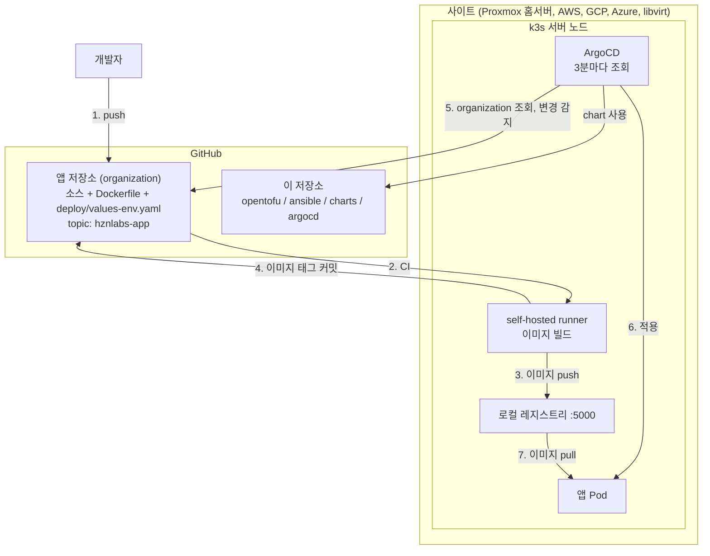

# iac-multicloud

서버(VM/CT)를 코드로 만들고, 그 위에서 어떤 앱이든 같은 방식으로 자동 배포하기 위한 IaC 저장소.
AWS/GCP/Azure와 로컬(Proxmox, libvirt)을 같은 코드 구조로 다룬다. 실제 동작을 검증한 환경은 Proxmox 홈서버다.

이 저장소가 하는 일은 두 가지다.

1. **서버 만들기**: OpenTofu로 VM/CT를 만들고, 필요하면 Ansible로 k3s와 ArgoCD까지 설치한다.
2. **앱 배포**: 앱 저장소에 push하면 이미지가 빌드되고 ArgoCD가 자동으로 배포한다. 새 앱을 추가해도 이 저장소는 수정하지 않는다.

전체 계획과 진행 상황은 [CLAUDE.md](./CLAUDE.md), 구조 설명은 [docs/architecture.md](./docs/architecture.md)를 본다.

## 아키텍처



- **인프라(push 기반)**: `plan.yml`(PR)과 `deploy.yml`(main)이 OpenTofu와 Ansible을 실행한다. CI가 plan/apply할 환경은 리포지토리 변수 `CI_ENVIRONMENTS`(예: `["proxmox"]`)로 지정하고, 미설정이면 아무 환경도 실행하지 않는다. 환경별 동작(러너 라벨, tofu apply 여부, 인벤토리 방식)은 `.github/environments.json`에 정의한다.
- **앱 배포(pull 기반)**: 클러스터마다 독립 설치된 ArgoCD가 GitHub organization에서 topic `hznlabs-app`과 `deploy/values-<env>.yaml`이 있는 저장소를 찾아 이 저장소의 범용 chart(`charts/app`)로 배포한다. CI는 클러스터에 접근하지 않는다.
- **사설망 CI**: GitHub 호스팅 러너가 닿지 않는 사설망은 k3s 노드에 self-hosted runner 컨테이너(`ansible/roles/github-runner`)를 띄운다. 저장소 단위 또는 organization 단위로 등록할 수 있다.

## 디렉터리

| 경로 | 내용 |
|---|---|
| `opentofu/modules/` | provider별 `network`/`compute-*` 모듈. 입출력 이름을 통일(`network_id`/`subnet_id`, `instance_id`/`instance_ip`). `compute-proxmox`(VM), `compute-proxmox-lxc`(CT) 포함 |
| `opentofu/environments/` | `aws`, `gcp`, `azure`, `libvirt`, `proxmox`(k3s 노드 VM), `proxmox-servers`(k3s와 무관한 범용 VM/CT) |
| `opentofu/bootstrap/` | 원격 tfstate 저장소(S3/GCS/Storage Account) 1회성 생성 |
| `opentofu/templates/` | tofu output으로 Ansible inventory를 만드는 템플릿 |
| `ansible/roles/` | `common`, `k3s`, `registry`, `argocd`, `github-runner`, `proxmox-template`, `proxmox-lxc-template` |
| `ansible/playbooks/` | `site.yml`(k3s+레지스트리+ArgoCD), `proxmox-template.yml`, `proxmox-lxc-template.yml` |
| `charts/app/` | 범용 앱 Helm chart. 이미지/포트/env/probe/ingress를 values로 받는다 |
| `argocd/bootstrap/` | 클러스터당 1회 적용하는 루트 Application (`root-{env}.yaml`) |
| `argocd/apps/` | 환경별 ApplicationSet (`appset-{env}.yaml`). 앱 저장소를 자동 발견한다 |
| `examples/` | 앱 저장소 시작 템플릿 (`sample-hello-nestjs`). 배포 대상이 아니다 |
| `scripts/` | `set-repo-url.sh` — 포크/템플릿으로 쓸 때 `repoURL`과 organization을 한 번에 교체 |
| `policy/` | OPA(Conftest) 정책 — PR 단계에서 `tofu plan` 결과 검증 (인스턴스 타입 허용 목록, SSH 0.0.0.0/0 차단) |
| `.github/` | `plan.yml`, `deploy.yml`, 재사용 workflow `build-app-image.yml`, `environments.json`, 보조 스크립트 |

## 사전 준비물

```bash
brew install opentofu ansible ansible-lint helm conftest actionlint
```

환경별 준비(클라우드 자격증명, libvirt 호스트, Proxmox API 토큰 등)는 [docs/onboarding.md](./docs/onboarding.md)를 본다.

## 빠른 시작: k3s 클러스터 만들기

저장소 루트에서 시작한다.

```bash
# 1) (클라우드만, 1회) 원격 state 백엔드 생성 — 실비용 발생
(cd opentofu/bootstrap/aws && tofu init && tofu apply)

# 2) VM 생성
cd opentofu/environments/<env>
cp terraform.tfvars.example terraform.tfvars   # 값 채우기 (gateway, IP 등 필수 값 포함)
tofu init && tofu apply
cd -

# 3) k3s + 레지스트리 + ArgoCD 설치
cd ansible
ansible-galaxy collection install -r requirements.yml
ansible-playbook -i inventories/<env>/hosts.ini playbooks/site.yml

# 4) GitOps 시작 (클러스터당 1회)
export KUBECONFIG=fetched/<node-ip>-kubeconfig.yaml
kubectl apply -f ../argocd/bootstrap/root-<env>.yaml
```

Proxmox는 템플릿 VM(9000)을 먼저 만들어야 한다. 순서는 [docs/new-site-checklist.md](./docs/new-site-checklist.md)를 따른다.

## 앱 배포하기

앱 저장소를 organization 아래에 만들고 topic `hznlabs-app`과 `deploy/values-<env>.yaml`, 빌드 workflow를 추가하면 된다. 이 저장소는 수정하지 않는다. 클러스터를 처음 준비할 때 GitHub 토큰 Secret과 organization 러너를 한 번 설정해야 한다. 절차는 [docs/adding-an-app.md](./docs/adding-an-app.md)에 있다.

## 범용 서버(VM/CT)만 만들기

k3s 없이 서버만 필요하면 `opentofu/environments/proxmox-servers`의 `vms`/`containers` map에 한 줄을 추가하고 `tofu apply` 한다. CT 템플릿(9100)에는 Ubuntu 26.04, docker, compose, git이 들어 있다. 절차는 [docs/new-site-checklist.md](./docs/new-site-checklist.md)의 "범용 서버" 절에 있다.

## 문서

- [docs/architecture.md](./docs/architecture.md) — 두 가지 흐름(서버 생성, 앱 배포), 사설망과 러너, 현재 상태
- [docs/tech-stack.md](./docs/tech-stack.md) — 도구별 역할을 비유로 설명 (인프라 입문자용)
- [docs/onboarding.md](./docs/onboarding.md) — 환경별 준비물, CI 시크릿/변수, 자주 막히는 지점
- [docs/new-site-checklist.md](./docs/new-site-checklist.md) — 새 사이트(Proxmox, 클라우드 계정) 추가, 범용 서버 생성
- [docs/adding-a-node.md](./docs/adding-a-node.md) — 노드 추가, 새 환경 추가
- [docs/adding-an-app.md](./docs/adding-an-app.md) — 새 앱 추가 절차
