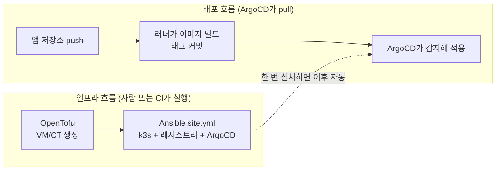
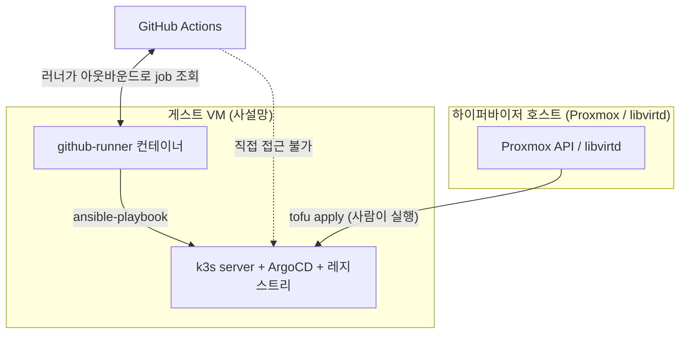
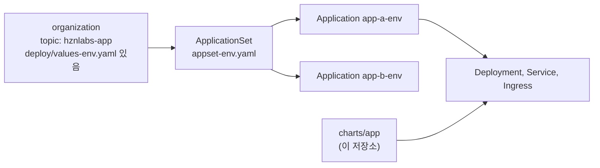

# 아키텍처 가이드

이 저장소에는 서로 다른 두 흐름이 있다. 서버를 만드는 **인프라 흐름**(push 기반)과, 앱을 올리는 **배포 흐름**(pull 기반)이다.
둘을 구분해서 보면 구조가 단순해진다. 도구가 낯설면 [tech-stack.md](./tech-stack.md)를 먼저 본다.

## 1. 두 가지 흐름

| | 인프라 흐름 | 배포 흐름 |
|---|---|---|
| 하는 일 | VM/CT 생성, k3s·ArgoCD 설치 | 앱 이미지 빌드, 클러스터에 반영 |
| 방향 | push (SSH/API로 서버에 접근) | pull (ArgoCD가 git을 조회) |
| 실행 주체 | 사람, 또는 `deploy.yml`(self-hosted runner) | GitHub Actions 러너 + ArgoCD |
| 빈도 | 사이트 구축, 노드 추가 때 | 앱 push마다 |
| 사설망 문제 | 있음 (GitHub 러너가 못 들어옴) | 없음 (클러스터가 밖으로 나가 조회) |

## 2. 인프라 흐름

### 구성 요소와 책임

| 단계 | 도구 | 책임 |
|---|---|---|
| 1 | OpenTofu (`opentofu/environments/<env>`) | VM/CT 생성. 완료 후 Ansible inventory(`hosts.ini`) 자동 생성 |
| 2 | Ansible `common` | 패키지, 타임존, 비밀번호 없는 sudo, UFW(SSH 허용, 기본 deny) |
| 3 | Ansible `k3s` | k3s server/agent 설치, UFW 포트(6443, 10250, 8472/udp), nerdctl-full + buildkitd(k3s containerd 소켓), kubeconfig를 `ansible/fetched/`로 가져옴 |
| 4 | Ansible `registry` | 서버 노드에 로컬 레지스트리(:5000, nerdctl+systemd), 모든 노드에 `registries.yaml` mirror 설정 |
| 5 | Ansible `argocd` | Helm 설치 후 ArgoCD 설치. 초기 admin 비밀번호 출력 |
| 선택 | Ansible `github-runner` | self-hosted runner 컨테이너 (`--tags github-runner`로만 실행) |

`site.yml`은 1~5단계를 순서대로 처리하고, 러너는 명시할 때만 설치한다. ArgoCD는 **클러스터마다 독립으로** 설치한다(hub-and-spoke 아님).
그래서 로컬 클러스터에 외부에서 접근할 필요가 없다. 설치 후 `argocd/bootstrap/root-<env>.yaml`을 클러스터당 한 번 적용하면 GitOps가 시작된다.

### 환경

| 환경 | 대상 | 비고 |
|---|---|---|
| `proxmox` | Proxmox 홈서버의 k3s 노드 VM | cloud-init 템플릿 clone, 고정 IP. **검증 완료** |
| `proxmox-servers` | k3s와 무관한 범용 VM/CT | `vms`/`containers` map. state가 `proxmox`와 분리됨 |
| `libvirt` | Linux KVM 호스트의 VM | 코드만 작성됨, 실제 호스트 미확보 |
| `aws` / `gcp` / `azure` | 클라우드 VM + k3s | 코드만 작성됨, 원격 state 백엔드 필요 |

provider 모듈은 입출력 이름을 통일해서(`network_id`/`subnet_id`, `instance_id`/`instance_ip`) `environments/` 층에서만 provider를 바꾼다.
클라우드 환경은 원격 backend를 쓴다. 로컬 backend를 쓰면 CI의 일회용 러너가 매번 state를 잃어 리소스가 중복 생성되기 때문이다.

### CI

- `plan.yml`: PR에서 `tofu plan` 후 Conftest(`policy/`)로 검증하고 결과를 PR 코멘트로 남긴다. 정책은 인스턴스 타입 허용 목록과 SSH(22)의 0.0.0.0/0 노출 차단이다.
- `deploy.yml`: main에 `opentofu/**` 또는 `ansible/**` 변경이 들어가면 `tofu apply` 후 `ansible-playbook`을 실행한다.
- 대상 환경은 리포지토리 변수 `CI_ENVIRONMENTS`로 지정한다. 환경별 러너 라벨, tofu apply 여부, 인벤토리 방식은 `.github/environments.json`에 있고, 새 환경은 거기에 항목만 추가하면 된다.
- proxmox는 `tofu_apply: false`, `inventory: dynamic`이다. 러너가 관리 대상 VM 안에서 돌고 tfstate가 로컬이라, CI가 apply하면 state를 잃고 VM을 재생성하려 하기 때문이다. 그래서 VM 생성은 사람이 하고, CI는 이미 떠 있는 클러스터에 `ansible-playbook`만 다시 적용한다. 이때 inventory는 `k3s kubectl get nodes`로 노드 IP를 조회해 매번 만든다.

## 3. 사설망과 self-hosted runner

Proxmox나 libvirt의 VM은 사설망 안에 있어 GitHub 호스팅 러너가 직접 들어갈 수 없다.
해결책은 반대 방향 연결이다. 사설망 안의 VM에 러너 컨테이너를 띄우면 러너가 GitHub으로 job을 **가져오러 나가므로** 인바운드 포트가 필요 없다.

러너 role(`ansible/roles/github-runner`)의 동작은 다음과 같다.

- `github_runner_repo`가 `owner/repo`면 **저장소 러너**, `org`처럼 슬래시가 없으면 **organization 러너**로 등록한다. organization 러너는 조직의 모든 저장소가 하나를 공유하므로 앱 저장소가 늘어도 러너를 더 설치하지 않는다 (PAT 권한: fine-grained는 Organization의 `Self-hosted runners` 읽기/쓰기, classic은 `admin:org`).
- `github_runner_build_tools_enabled: true`면 러너 컨테이너에 nerdctl, buildkit·containerd 소켓을 마운트해서 이 러너가 이미지를 직접 빌드하고 로컬 레지스트리에 push할 수 있다. k3s가 설치된 노드에서만 켠다.
- 라벨은 환경 `group_vars`(예: `self-hosted,proxmox`)로 정하고, workflow의 `runs-on`과 일치해야 한다.
- k3s를 재시작하면 러너가 같이 내려가 진행 중인 job이 끊길 수 있다(`Requires=k3s.service`).
- 러너가 없는 환경을 `CI_ENVIRONMENTS`에 넣으면 job이 최대 24시간 대기하고, `concurrency` 그룹 때문에 같은 ref의 이후 push가 모두 막힌다. 러너가 Idle인 것을 확인한 뒤에만 지정한다.

### libvirt: 러너가 tofu apply까지 처리하는 구조

libvirt는 daemon과 원격 클라이언트 구조라 `libvirt_uri`를 `qemu+ssh://user@호스트IP/system`으로 주면, 게스트 VM 안의 러너 컨테이너가 물리 호스트의 libvirtd에 접속해 다른 VM을 만들 수 있다.
`ansible/inventories/libvirt/group_vars/all.yml`이 클라이언트 라이브러리(`libvirt-clients`)를 러너에 추가 설치하도록 설정해 두었다. 실제 Linux/libvirtd 호스트가 없어 아직 검증하지 못했다.

## 4. 배포 흐름

앱 하나가 배포되는 과정이다.

1. 개발자가 앱 저장소(organization 소속, topic `hznlabs-app`)에 push한다.
2. 앱 저장소의 workflow가 이 저장소의 재사용 workflow `build-app-image.yml`을 호출한다.
3. organization 러너가 이미지를 빌드해 같은 노드의 로컬 레지스트리에 `<노드IP>:5000/<앱 저장소 이름>:<git sha 7자리>`로 push한다.
4. 러너가 앱 저장소의 `deploy/values-<env>.yaml`에 `image.repository`/`image.tag`를 기록하고 앱 저장소에 커밋한다. 앱 저장소 자신에 커밋하므로 별도 토큰이 필요 없다.
5. 클러스터의 ArgoCD ApplicationSet(`argocd/apps/appset-<env>.yaml`)이 3분마다 organization을 조회한다. topic과 `deploy/values-<env>.yaml` 조건을 만족하는 저장소마다 Application `<저장소>-<env>`를 만든다.
6. Application은 두 소스를 합친다. chart는 이 저장소의 `charts/app`, values는 앱 저장소의 `deploy/values.yaml`과 `deploy/values-<env>.yaml`이다.
7. ArgoCD가 Deployment, Service, Ingress를 만들고, 이후 태그가 바뀔 때마다 롤링 업데이트한다. 파드는 레지스트리의 노드 IP 주소로 이미지를 받는다.

- **앱 내리기**: topic을 떼거나 `deploy/values-<env>.yaml`을 지우면 Application이 사라지고, finalizer(`resources-finalizer`)로 워크로드도 함께 정리된다.
- **환경 선택**: `deploy/values-<env>.yaml`을 둔 환경에만 배포된다. 환경마다 ApplicationSet이 하나씩 있다.
- **자동 동기화**: `automated`(prune, selfHeal)라서 git에 적힌 상태가 정답이다. 클러스터에서 손으로 바꾼 것은 되돌려진다.
- **범용 chart가 안 맞는 앱**: 이 저장소의 `argocd/apps/<app>-<env>.yaml`에 Application을 직접 쓴다. 이때만 이 저장소를 수정한다.
- **전제 조건**: ArgoCD의 GitHub 토큰 Secret(`github-token`)과 organization 러너. 개인 계정은 ArgoCD SCM Provider가 조회하지 못해서 organization이 필요하다. 절차는 [adding-an-app.md](./adding-an-app.md)에 있다.

## 5. 현재 상태

| 영역 | 상태 | 비고 |
|---|---|---|
| Proxmox: VM 생성, k3s, 레지스트리, ArgoCD, 러너 | 검증 완료 (2026-10-18~20) | k3s VM `.122`, CI deploy job(ansible)까지 확인 |
| Proxmox: 범용 CT 템플릿(9100) 생성 | 검증 완료 | 플레이북 실환경 실행 성공, CT 1대 생성(`proxmox-servers`) 확인 |
| 범용 서버 안에서 docker 실행 | 미검증 | `docker run hello-world` 확인이 남아 있음 |
| 앱 배포: ApplicationSet(SCM Provider), 범용 chart, 재사용 workflow, organization 러너 | 코드 완료, 실환경 미검증 | 이전 방식(저장소 내 앱, 이미지 빌드 자동화)은 Proxmox에서 검증했으나 현재 방식으로 교체됨 |
| libvirt | 코드만 | Apple Silicon의 Lima VM(KVM 없음, TCG)로 시험했으나 부팅이 극도로 느려 중단. 실제 KVM 호스트에서 재검증 필요 |
| aws / gcp / azure | 코드만 | 원격 state 백엔드(`opentofu/bootstrap/*`)와 자격증명이 아직 없음. 실비용이 발생해서 사용자가 직접 실행 |

libvirt 시험에서 확인한 사실은 두 가지다. 모듈은 `domain_type`(KVM 없는 호스트용)과 cloud-init를 일반 disk로 붙이는 수정이 반영돼 있다. 그리고 storage pool을 `virsh pool-define-as`로 직접 만들면 libvirt가 AppArmor 화이트리스트에 볼륨 경로를 넣지 못해 `Permission denied`가 날 수 있다([onboarding.md](./onboarding.md) 참고).
